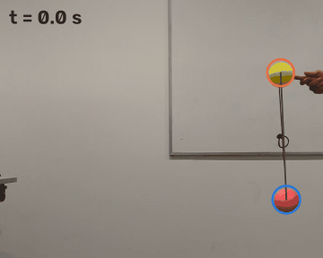
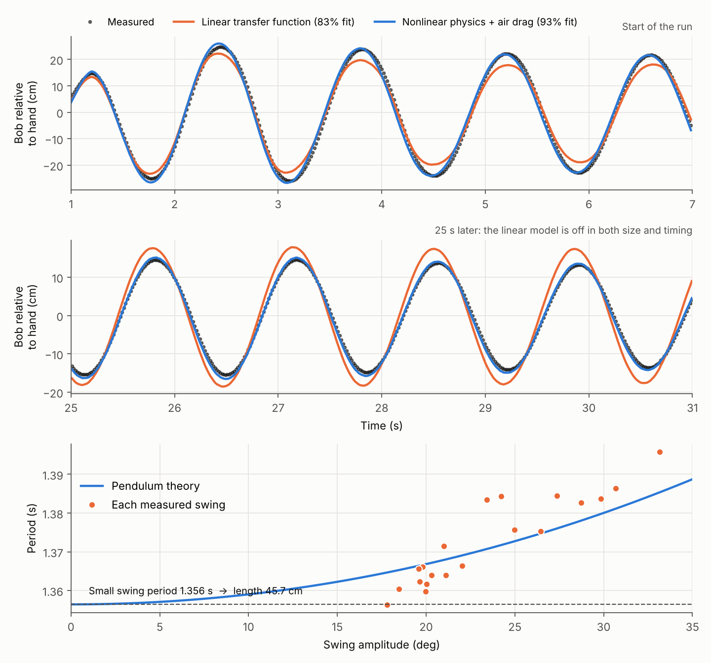
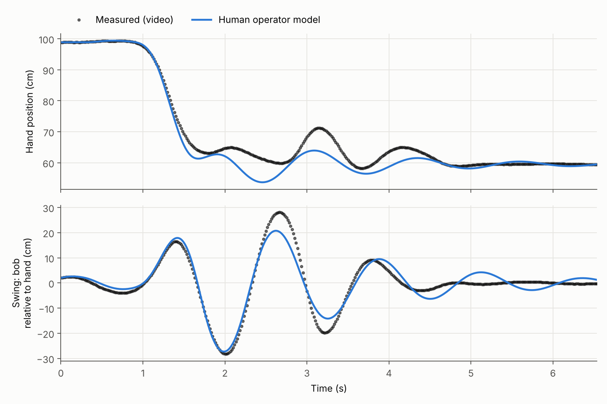
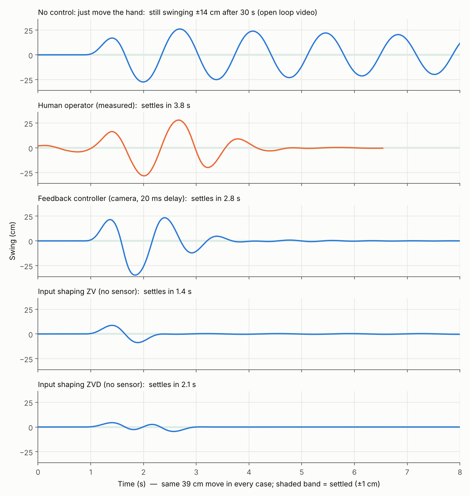
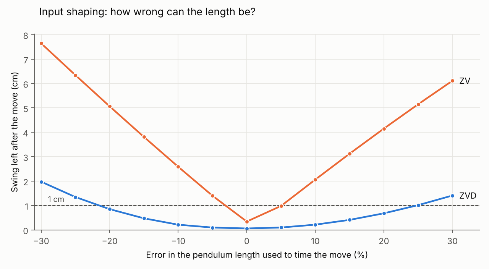

# Pendulum Anti-Sway: Human vs Feedback Control vs Input Shaping

A person moves a hanging pendulum 39 cm sideways and tries to stop it swinging. I filmed it on a phone, tracked both balls with computer vision, and identified two systems from the video: the pendulum and the person acting as its controller. Then I used the identified models to compare the human against an automatic feedback controller and against input shaping (no sensor at all).

It's the same problem as crane and gantry anti-sway, or a robot arm moving a hanging load.



**Results for the same 39 cm move:**

| Strategy | Settles within ±1 cm | Peak swing |
|---|---|---|
| No control (just move the hand) | still ±14 cm after 30 s | 27 cm |
| Human operator (measured) | 3.8 s | 28 cm |
| Feedback controller (20 ms sensing delay) | 2.8 s | 35 cm |
| Input shaping ZV, timed from the video | **1.4 s** | 9 cm |
| Input shaping ZVD, robust version | 2.1 s | **4.5 cm** |

---

## 1. Tracking

[`src/track.py`](src/track.py) uses OpenCV. Each frame goes through an HSV colour threshold, a morphological clean up and a largest blob search, giving the centre of the yellow ball (the hand / pivot) and the pink ball (the bob) at 60 fps. Swing angle comes from the line between them, so it doesn't depend on the camera scale.

## 2. Self calibration: the pendulum is the ruler

There was no ruler in the shot, so the pendulum's own period sets the scale:

- Each swing period is measured, then corrected for amplitude (a 30° swing runs about 1.7% slower than a small one).
- Small swing period **1.356 s** gives an effective length **45.7 cm**, which works out to **1.05 mm per pixel**.
- Cross check: the balls then measure 83 mm and 77 mm across, which looks right for the real balls.

## 3. Pendulum model: physics beats the textbook transfer function



| Model | Fit to 32 s of free swing |
|---|---|
| Linear 2nd order transfer function (viscous damping) | 83% |
| **Nonlinear pendulum, moving pivot, quadratic air drag** | **93%** |

- The linear model can't match it. The real period changes with amplitude (bottom plot), and the swing decays the way air drag makes it decay, not the way viscous damping does.
- In the nonlinear fit, viscous damping goes to almost zero and air drag takes over completely.
- Physics check: with a sphere drag coefficient of 0.47, the fitted drag implies a bob mass of about **11 g**. That's a believable weight for a light hollow plastic ball (I didn't weigh it).

## 4. The person as a controller



The human model has three parts:
- **Planned move:** a minimum jerk path.
- **Reaction delay** τ and a gain on where the bob is relative to the hand: x_cmd = r(t) + K·e(t − τ).
- **Arm lag:** 0.1 s, the typical value for the arm's own response delay in human operator models.

| Identified | Value |
|---|---|
| Reaction delay | **0.31 s** (typical human visual reaction is 0.2 to 0.3 s) |
| Gain | 0.22 (hand moves 22% of the bob's offset) |
| Planned move | 39 cm in 0.77 s |
| Fit | 78% hand, 73% swing |

**What it shows:**
- A delay of about a quarter swing (83° at the 4.6 rad/s swing frequency) means the hand moves out of phase with the bob, and that takes energy out of the swing.
- Simulations with the same model show that, for a "chase the bob" strategy, about 0.3 s of delay is close to the best possible (0.1 s: 4.5 s to settle, 0.3 s: 2.6 s, 0.4 s: 10.6 s). So the reaction delay helps here rather than hurts.
- The person's gain (0.22) was on the low side. At the same delay, a gain of 0.35 would settle in 2.6 s instead of 3.8 s.

**Honest limit:** with one dominant swing frequency, the data can only pin down the person's gain and phase at that frequency. A different mix of delay and lead would fit just as well. The model is kept to the simplest strategy.

## 5. Same move, three ways to control it



- **Feedback controller.** The same arm, but a camera with a 20 ms delay instead of 0.3 s. It uses position and velocity feedback on the swing, with gains from a grid search on the identified model. It beats the person by 1 s, but it still has to let the swing build up before it can kill it.
- **Input shaping (ZV).** No sensor at all. The move is split into two half moves, half a swing period apart, so the second one cancels the swing the first one starts. The timing comes straight from the period measured in the video. It settles in 1.4 s, almost 3 times faster than the human.
- **ZVD.** Three steps (¼, ½, ¼) over a full period. Slower, but much more tolerant of a wrong length:



ZV stays under 1 cm only if the length is within a few percent. ZVD stays under 1 cm from −20% to +20%. That's the tradeoff behind crane anti-sway systems: ZV when the cable length is known, ZVD (or feedback on top) when it changes.

## Tests

`python -m unittest discover -v tests`: 6 checks on synthetic data with known answers.

| Check | What it confirms |
|---|---|
| Tracker | Ball centres found within 1 px on a drawn test frame |
| Calibration | Length recovered within 0.2% from swings up to 30° |
| Drag fit | Length and air drag recovered from a simulated swing |
| Energy | No drag means no energy loss in the pendulum simulator |
| Input shaping | A ZV move cuts residual swing by over 90% |
| Human fit | Known gain and reaction delay recovered from a simulated closed loop run |

**Bug caught by testing:** the drag fit first estimated the camera tilt as the median swing angle. That's biased when the swing decays, and it threw the drag estimate off by 8%. The tilt is now fitted along with the other parameters.

## Run it

```bash
pip install -r requirements.txt
python src/track.py ol.mp4 data/ol_track.csv     # only needed with new videos; tracks are included
python src/run_analysis.py                        # fits, comparisons, figures, results.json (about 2 min)
python -m unittest discover -v tests
```

## Repo layout

```
src/track.py         OpenCV colour tracking -> CSV
src/pendulum.py      loading, self calibration, linear and nonlinear plant models
src/human.py         closed loop simulator (delay, arm lag, pendulum) and human operator fit
src/run_analysis.py  full pipeline, figures and results.json
src/make_gif.py      tracking preview GIF
data/                tracked ball positions from both videos (60 fps)
results.json         every identified number
```

The raw videos aren't included (129 MB and 26 MB).

## Background

This builds on a lab from Systems Modelling and Analysis (University of Melbourne, 2023, part of my Master of Mechatronics Engineering). The lab recorded this experiment and fitted black box transfer functions with MATLAB scripts the subject provided. Everything here is my own later work in Python: the tracking, self calibration, physics model, human operator model, controller comparison and tests. No assignment answers are included.
